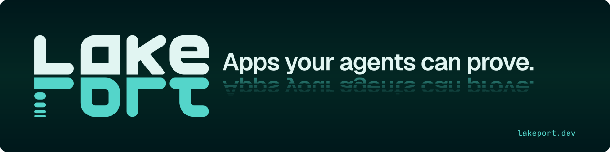

**Lakeport is a Lean 4 app framework, in development.** You write an app's views,
state, effects and contracts in Lean, state what must hold, and the Lean kernel checks
it. Compiled Lean Wasm is the web route.

It is early. Every proof claim names its statement and the axioms behind it, and gates
that have not passed are reported as open. No supported platform or production
readiness is claimed yet.

- [lakeport.dev](https://lakeport.dev): the site and the engineering manual
  ([source](https://github.com/lakeport/lakeport-www))
